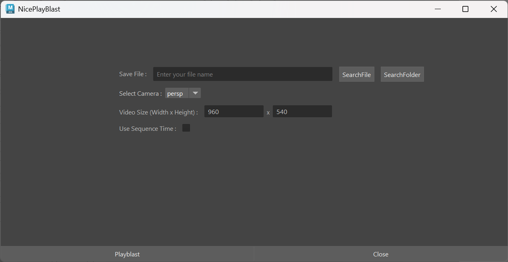

# NicePlayblast

# Overview
授業で提出するためにPlayblastをいい感じに使えるスクリプト

# Requirement
- Windows 11
- Maya 2026

# Usage
nicePlayblast.pyをスクリプトエディターで読み込んで実行

1. Save File:のテキストボックスに<保存したいディレクトリ>\\<ファイルの名前>を入力する。拡張子は任意。SearchFile, SearchFolderボタンはファイルやフォルダをダイアログから選択できる。
2. Select Camera: からシーン内にある任意のカメラを選択。スクリプト後に作成したカメラであっても、ドロップダウンリストを展開するときに更新が入るので大丈夫。
3. VideoSizeから動画として出力したい大きさを入力。横x縦。
4. Use Sequence Time: をオンにするとシーケンスタイムを有効にして動画を出力する。CameraSequencerを使っているときはオンにすると良い。
5. PlayBlastボタンを押すとPlayblastを実行する。Closeを押すとスクリプトを終了するので注意。

# Feature
- フォームで入力した値はoptionVarコマンドによってPlayblastを実行する直前にローカルへ保存される。
- Save File: に存在しないファイルの名前を指定すると新規の動画ファイルを作成する。存在するファイルを指定すると上書き保存する。上書き保存する際に警告は出ないので注意。 また、相対パスでファイルを指定した場合カレントディレクトリはセットされているプロジェクトのルートになる。さらに、ファイル名のみを指定した場合はカレントディレクトリをプロジェクトでMoviesに指定しているフォルダ以下として扱う。つまりプロジェクトのMovie下に動画を保存したい場合は単に名前を指定するだけでよい。
- 動画のフォーマットはデフォルトでQuickTime(qt)、圧縮方式はH.264を使う(授業の都合上)。それらが使えない場合はフォーマットをAVI、圧縮方式はIYUVを使用する。
- ResolutionGate, GateMaskはPlayblast実行前にオフにされ、実行後は実行前の状態に復帰する。
- アニメーションに不必要なオブジェクトはplayblast実行前に自動で非表示に設定される。この設定はPlayblastを実行用に一時的に作成したmodelPanelのみに設定されるので現時点で表示されているパネルに影響はない。
